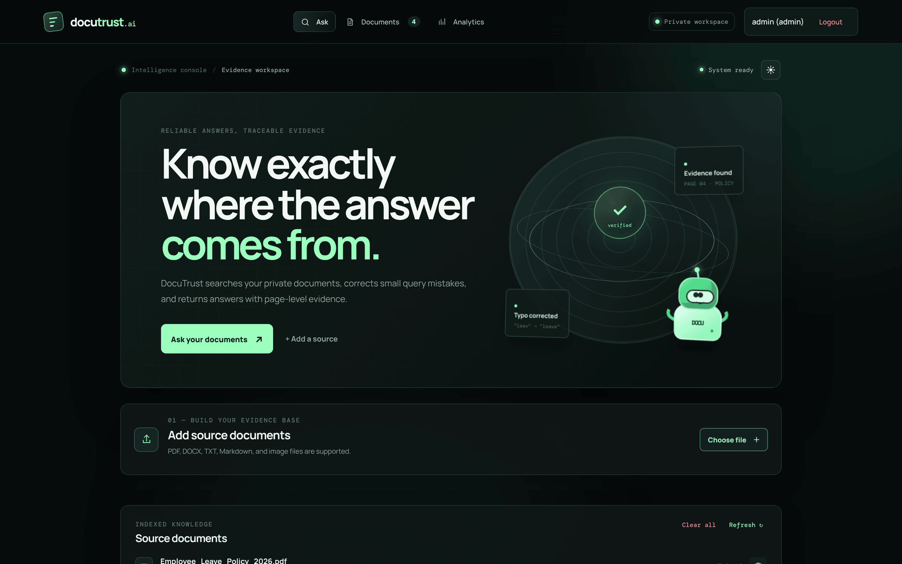
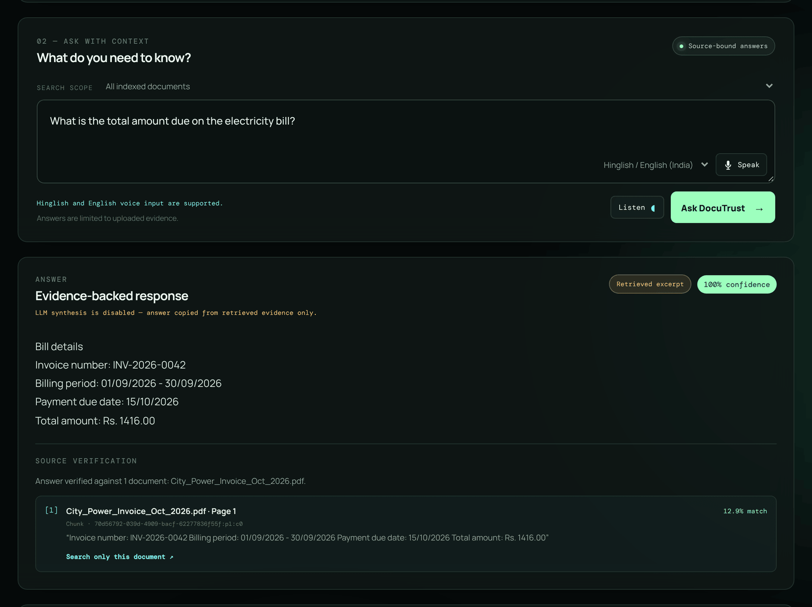
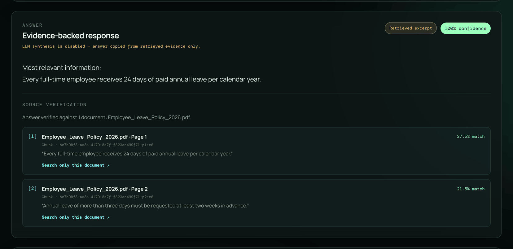
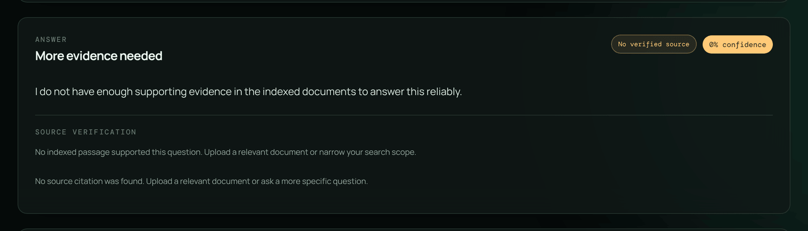
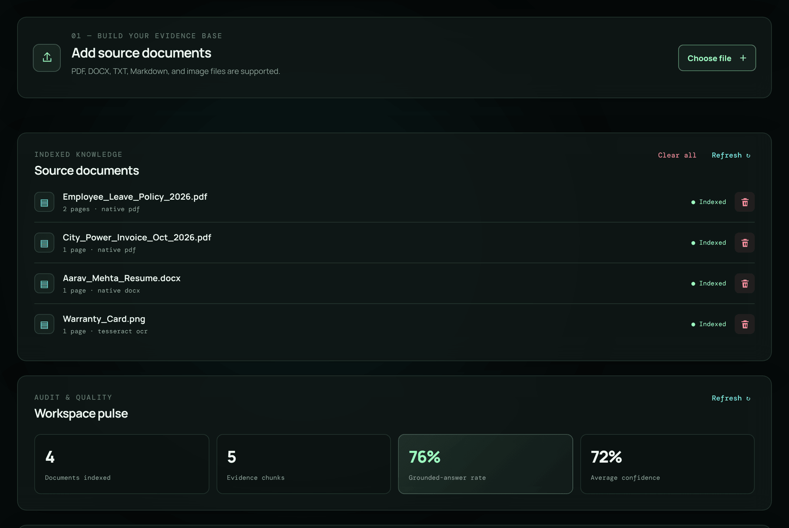
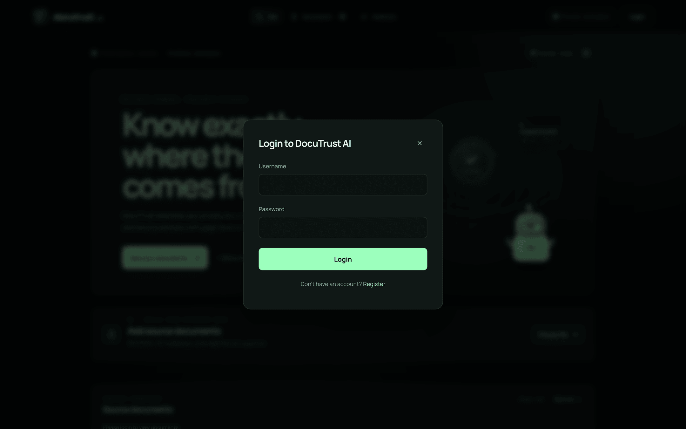
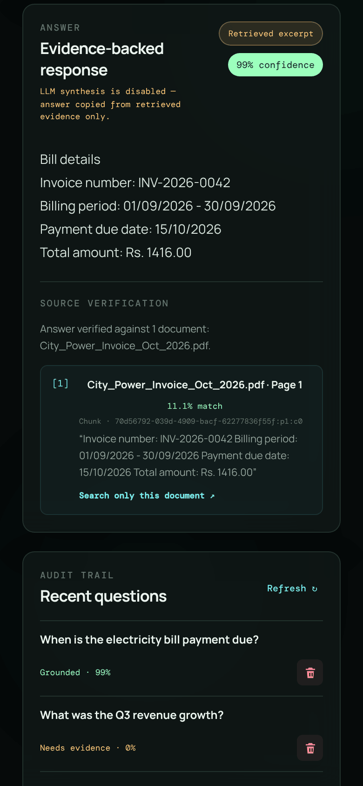

<div align="center">

# DocuTrust AI

**Ask questions about your documents and get answers you can check, with the exact page and passage behind every claim.**

[**Live demo → docutrust-ai.netlify.app**](https://docutrust-ai.netlify.app)




</div>

DocuTrust AI is a citation-grounded question-answering app (retrieval-augmented generation, or RAG) for policies, contracts, invoices, resumes and other business documents. You upload files, it indexes them, and when you ask a question it answers **only from what it finds**, showing the document, page and quote it used. When the evidence isn't there, it says so instead of guessing.

> **Evidence first.** Every answer comes with its citations. If retrieval can't clear the confidence threshold, the API returns `insufficient_evidence` rather than a confident-sounding answer.

## Contents

- [Screenshots](#screenshots)
- [Features](#features)
- [How it works](#how-it-works)
- [Architecture](#architecture)
- [Getting started](#getting-started)
- [Configuration](#configuration)
- [API reference](#api-reference)
- [Testing](#testing)
- [Project structure](#project-structure)
- [Limitations](#limitations)
- [Roadmap](#roadmap)
- [License](#license)

## Screenshots

### Answers with source verification

Ask a question in plain English. The answer is followed by each passage it came from, with its document, page, chunk ID and match score.



Questions can draw on several passages, each cited separately:



### It refuses when the evidence isn't there

Nothing in the uploaded documents mentions revenue, so DocuTrust declines rather than inventing a figure:



### Documents and workspace analytics

PDFs, Word files and images (read with OCR) sit side by side, with live counts of indexed chunks, grounded-answer rate and average confidence.



### Sign-in and mobile

<table>
  <tr>
    <td width="68%"></td>
    <td width="32%"></td>
  </tr>
</table>

<sub>Screenshots show the real app running with sample documents (an employee leave policy, an electricity bill, a resume and a photographed warranty card). They show the default evidence-copy mode; on the live site, answers can also be written by an LLM with inline `[S1]` citations.</sub>

## Features

**Documents**
- Upload **PDF, DOCX, TXT, Markdown, PNG, JPG/JPEG, TIFF and BMP** files.
- Native text extraction for PDF and DOCX; **OCR for images** with Tesseract.
- Page-aware chunking (900 characters, 150 overlap) so every citation can name its page.

**Answers you can trust**
- Explainable TF-IDF-style retrieval that returns the top five passages, with no external search service needed.
- **Typo correction** against the words actually in your documents (`"nmae"` → `"name"`), shown to the user.
- A **confidence threshold** that makes the app abstain instead of guessing.
- Field-aware answers for common documents, such as invoice number, billing period, due date and total for bills, validity periods for tax receipts, and name, email, skills and education for resumes.
- **Optional LLM synthesis** through any OpenAI-compatible API, told to answer only from the cited sources. If the LLM fails or abstains, the app falls back to copying from the evidence, so a provider outage never breaks a query.

**Accounts and control**
- Login with **JWT** and **bcrypt**-hashed passwords.
- **Role-based access**: `admin`, `user` (can upload) and `viewer` (read-only).
- **Per-document sharing**: by default you only see your own documents. Grant or revoke access for other users, or let an admin see everything.
- An **audit trail** of every question with its status, confidence and cited chunks, plus workspace analytics.
- Per-IP **rate limits** on login, registration, upload and query.

**Interface**
- A single-page workspace with dark and light themes, voice input (English and Hinglish), read-aloud answers and a mobile layout.

## How it works

```text
 Upload                          Ask
   │                              │
   ▼                              ▼
 Extract text ──► Chunk pages   Correct typos against the corpus
 (PDF · DOCX · OCR)   │           │
                      ▼           ▼
                Postgres ───► Score chunks (TF × smoothed IDF) ──► top 5 passages
                                                                       │
                                            confidence = min(1, top score × 9)
                                                                       │
                                     ┌─────────────────────────────────┴──────────────┐
                              ≥ threshold                                       < threshold
                                     │                                                │
                       Optional LLM answer (sources only)               "insufficient_evidence"
                       └─ fallback: copy from best evidence                 (no answer given)
                                     │
                         Answer + citations + audit event
```

1. **Ingest.** Uploaded files are validated, their text is extracted, and each page is split into overlapping chunks. Chunk IDs encode their source: `{document_id}:p{page}:c{n}`.
2. **Retrieve.** The question and chunks are tokenised, stop words removed and suffixes lightly stemmed. Each chunk is scored by term frequency × smoothed inverse document frequency, and only documents the user may access are searched.
3. **Decide.** Confidence comes from the top score. Below `RETRIEVAL_THRESHOLD` (default `0.12`), the app abstains.
4. **Answer.** If an LLM is configured, it's given the retrieved passages and told to cite them as `[S1]`, `[S2]` and so on, or reply `INSUFFICIENT_EVIDENCE`. Otherwise, or on any LLM failure, the answer is copied from the best passage.
5. **Record.** Every question is logged with its status, confidence and cited chunk IDs.

Confidence is a heuristic score, not a calibrated probability. See [Limitations](#limitations).

## Architecture

The app runs entirely on Netlify:

| Layer | Implementation |
| --- | --- |
| Frontend | Static HTML/CSS/JS in [`app/static/`](app/static), served from Netlify's CDN |
| API | One TypeScript [Netlify Function](web/netlify/functions/api.mts) serving `/api/*` and `/health` |
| Logic | [`web/lib/`](web/lib): retrieval, extraction, auth, synthesis and data access |
| Database | Netlify Database (managed Postgres); schema in [`web/netlify/database/migrations/`](web/netlify/database/migrations) |
| PDF / DOCX / OCR | `unpdf`, `mammoth`, `tesseract.js` (English model bundled) |
| Auth | `jose` (HS256 JWT) and `bcryptjs` |
| LLM (optional) | Any OpenAI-compatible Chat Completions endpoint, including Netlify AI Gateway |

The project started as a **FastAPI + SQLite** backend, which is still in [`app/`](app) and runs locally. The Netlify API is a route-for-route TypeScript port with the same URLs, status codes and JSON shapes. Its retrieval code has been checked against the Python version and produces identical chunks, scores, corrections and answers.

## Getting started

### Use the live app

1. Open **https://docutrust-ai.netlify.app** and register, or log in.
2. Upload a document (up to 4 MB).
3. Ask a specific question using words from the document, such as *"When is the bill payment due?"*.
4. Check the **Source verification** panel before relying on the answer.

### Deploy your own copy on Netlify

1. Fork this repository.
2. In Netlify, choose **Add new project → Import from Git** and pick your fork. `netlify.toml` already sets the build, so keep the defaults.
3. Optionally add the admin variables (see [Configuration](#configuration)), then deploy.

Netlify provisions the Postgres database and applies the migrations on every deploy. More detail is in [NETLIFY_DEPLOYMENT.md](NETLIFY_DEPLOYMENT.md).

### Run locally

**Netlify version (TypeScript):**

```bash
npm install -g netlify-cli
cd web && npm install
netlify dev            # runs the UI, the API function and a local Postgres
```

**Original version (Python/FastAPI):**

```bash
./start.sh             # creates .venv, installs requirements, starts on :8000
# or manually:
python3 -m venv .venv && source .venv/bin/activate
pip install -r requirements.txt && cp .env.example .env
uvicorn app.main:app --reload
```

Then open <http://127.0.0.1:8000>; interactive API docs are at `/docs`. Image OCR in the Python version needs the Tesseract binary installed locally.

## Configuration

**On Netlify**, set variables under *Project configuration → Environment variables* with the **Functions** scope, then redeploy. **Locally (Python)**, use `.env` (copy it from `.env.example`). Every variable is optional.

| Variable | Default | Purpose |
| --- | --- | --- |
| `ADMIN_USERNAME`, `ADMIN_EMAIL`, `ADMIN_PASSWORD` | – | Creates the first **admin** account, but only while the database has no users. Public sign-up always creates regular users. |
| `OPENAI_API_KEY` | – | Turns on LLM-written answers. On Netlify, AI Gateway may supply this automatically, which uses your Netlify credits. |
| `OPENAI_BASE_URL` | `https://api.openai.com/v1` | Any OpenAI-compatible endpoint. |
| `OPENAI_MODEL` | `gpt-4.1-mini` | Model used for synthesis. |
| `RETRIEVAL_THRESHOLD` | `0.12` | Minimum confidence for a grounded answer. |
| `ACCESS_TOKEN_EXPIRE_MINUTES` | `30` | Login session length. |
| `JWT_SECRET_KEY` | auto | Netlify version: generated once and stored in the database if unset. Python version: set this yourself (`openssl rand -hex 32`). |
| `MAX_UPLOAD_BYTES` | 4 MB (Netlify) · 15 MB (Python) | Upload size limit. |
| `TESSERACT_CMD`, `DOCUTRUST_DATA_DIR`, `LOG_LEVEL` | – | Python version only: Tesseract path, SQLite folder, log level. |

## API reference

All endpoints except `/health`, register and login need an `Authorization: Bearer <token>` header. Errors are returned as `{"detail": "..."}`.

| Method | Endpoint | Who | Description |
| --- | --- | --- | --- |
| `GET` | `/health` | anyone | Status, whether LLM synthesis is on, document count |
| `POST` | `/api/v1/auth/register` | anyone | Create a regular user account |
| `POST` | `/api/v1/auth/login` | anyone | Get a JWT access token |
| `GET` | `/api/v1/auth/me` | signed in | Current user |
| `POST` | `/api/v1/documents` | user, admin | Upload and index a file (`multipart/form-data`, field `file`) |
| `GET` | `/api/v1/documents` | signed in | Documents you can access |
| `DELETE` | `/api/v1/documents/{id}` | user, admin | Delete a document and its chunks |
| `DELETE` | `/api/v1/documents` | admin | Delete every document |
| `POST` | `/api/v1/documents/{id}/permissions?username=&permission_level=` | user, admin | Share a document (`read`, `write` or `admin`) |
| `DELETE` | `/api/v1/documents/{id}/permissions/{username}` | user, admin | Stop sharing |
| `POST` | `/api/v1/query` | signed in | Ask a question; optional `document_ids` limits the search |
| `GET` | `/api/v1/query-history?limit=8` | signed in | Recent questions (1–50) |
| `DELETE` | `/api/v1/query-history/{id}` | signed in | Delete a history entry |
| `GET` | `/api/v1/analytics` | signed in | Document, chunk and query metrics |
| `GET` | `/api/v1/users` | admin | List users |
| `PUT` | `/api/v1/users/{username}/role?new_role=` | admin | Set `admin`, `user` or `viewer` |
| `PUT` | `/api/v1/users/{username}/disable?disabled=true` | admin | Disable or re-enable an account |

### Example

```bash
BASE=https://docutrust-ai.netlify.app

TOKEN=$(curl -s -X POST $BASE/api/v1/auth/login \
  -H "Content-Type: application/json" \
  -d '{"username":"you","password":"your-password"}' | jq -r .access_token)

curl -s -X POST $BASE/api/v1/documents -H "Authorization: Bearer $TOKEN" \
  -F "file=@City_Power_Invoice_Oct_2026.pdf"

curl -s -X POST $BASE/api/v1/query -H "Authorization: Bearer $TOKEN" \
  -H "Content-Type: application/json" \
  -d '{"question":"What is the total amount due on the electricity bill?"}'
```

```json
{
  "answer": "Bill details\nInvoice number: INV-2026-0042\nBilling period: 01/09/2026 - 30/09/2026\nPayment due date: 15/10/2026\nTotal amount: Rs. 1416.00",
  "answer_status": "grounded",
  "answer_source": "deterministic",
  "synthesis_error": "api_key_missing",
  "confidence": 1.0,
  "interpreted_question": "What is the total amount due on the electricity bill?",
  "corrections": [],
  "citations": [
    {
      "chunk_id": "70d56792-…:p1:c0",
      "document_id": "70d56792-…",
      "document_name": "City_Power_Invoice_Oct_2026.pdf",
      "page": 1,
      "section": null,
      "relevance_score": 0.1294,
      "supporting_quote": "Invoice number: INV-2026-0042 … Total amount: Rs. 1416.00"
    }
  ],
  "audit_event_id": "…"
}
```

| Field | Values |
| --- | --- |
| `answer_status` | `grounded` (enough evidence) or `insufficient_evidence` (abstained) |
| `answer_source` | `llm` (written by the LLM from the cited sources), `deterministic` (copied from evidence) or `abstained` |
| `synthesis_error` | Why the LLM wasn't used: `api_key_missing`, `timeout`, `http_<code>`, `network_error`, `malformed_response`, `llm_abstained` |

## Testing

| Suite | Command | Covers |
| --- | --- | --- |
| Python (41 tests) | `pytest -q` or `make test` | Retrieval, abstention and hallucination guardrails, synthesis fallbacks, auth, database |
| Netlify API (48 checks) | `cd web && npm test` | Every route against a throwaway Postgres: auth and roles, sharing, PDF/DOCX/TXT/OCR uploads, grounded and abstained answers, history, analytics, rate limits |
| Type check | `cd web && npx tsc --noEmit` | The TypeScript backend |

### Hallucination checks

[`tests/test_hallucination.py`](tests/test_hallucination.py) checks that the app abstains when the corpus doesn't contain the answer:

| Question | Indexed content | Expected |
| --- | --- | --- |
| *What is our encryption standard?* | Office-hours note only | Abstain |
| *When was the company founded?* | Leave policy only | Abstain |
| *What was Q3 revenue?* | Leave policy only | Abstain |
| *Who approves leave requests?* | Matching leave-policy passage | Grounded, cites page 2 |

For a manual check, open **Source verification** after any answer and confirm each claim appears in a cited quote on the named page.

## Project structure

```text
.
├── app/                          # Original FastAPI backend + the web UI
│   ├── main.py                   #   routes
│   ├── retrieval.py              #   chunking, ranking, confidence, answers
│   ├── extraction.py             #   PDF / DOCX / text / OCR
│   ├── synthesis.py              #   optional LLM answers
│   ├── auth.py, database.py      #   JWT auth, SQLite/Postgres access
│   └── static/                   #   UI (index.html, app.js, styles.css), used by both backends
├── web/                          # Netlify version
│   ├── netlify/functions/api.mts #   API entry point (/api/*, /health)
│   ├── netlify/database/migrations/
│   ├── lib/                      #   TypeScript port of app/*.py
│   └── tests/                    #   end-to-end API test + fixtures
├── tests/                        # Python tests
├── docs/screenshots/             # Images used in this README
├── output/pdf/                   # Project explanation report
├── netlify.toml                  # Netlify build config
├── NETLIFY_DEPLOYMENT.md         # Deployment notes
└── Dockerfile, Makefile, start.sh, requirements.txt   # Python tooling
```

The full write-up is in [output/pdf/DocuTrust_AI_Project_Explanation.pdf](output/pdf/DocuTrust_AI_Project_Explanation.pdf).

## Limitations

- **Keyword retrieval, not semantic search.** Questions work best when they use words that appear in the document; synonyms can be missed.
- **Confidence is heuristic.** It needs calibrating against a labelled question set before any high-stakes use.
- **Scanned PDFs aren't OCR'd.** Only image files are; a PDF with no text layer is rejected.
- **Upload limit is 4 MB on Netlify**, because Netlify Functions cap request bodies.
- **Rate limits are best-effort on Netlify**, since they're counted per function instance.
- **Name questions can be fooled by filenames.** The resume-name fallback treats any two-to-four-word filename (for example `Warranty_Card.png`) as a possible person's name.
- Citations make answers checkable, but they don't replace human review for compliance decisions.

## Roadmap

- Embedding search with a reranker, benchmarked against the current baseline
- Visual citations that open the PDF page and highlight the quoted sentence
- OCR for scanned PDFs, plus table and layout extraction
- Confidence calibration on a labelled dataset (recall@5, citation precision, faithfulness, abstention accuracy)
- Audit export, SSO and data-retention controls

## License

[MIT](LICENSE)
